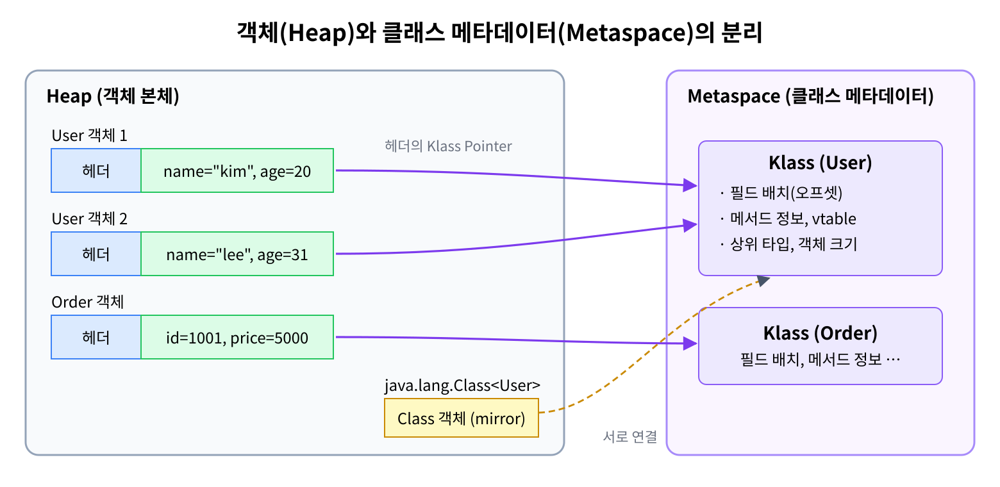
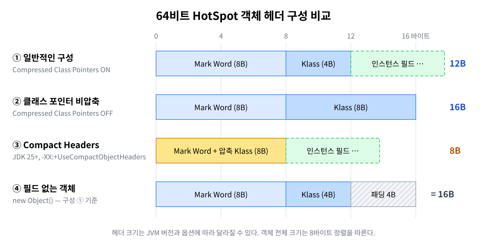
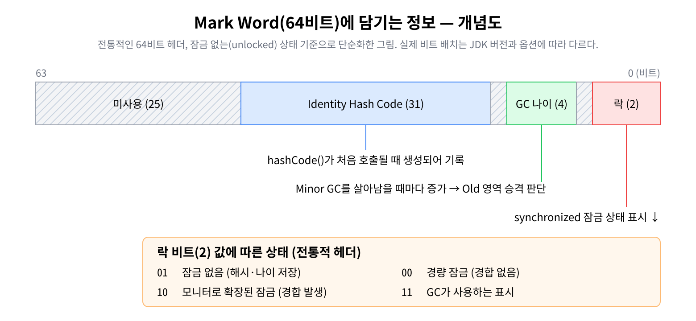
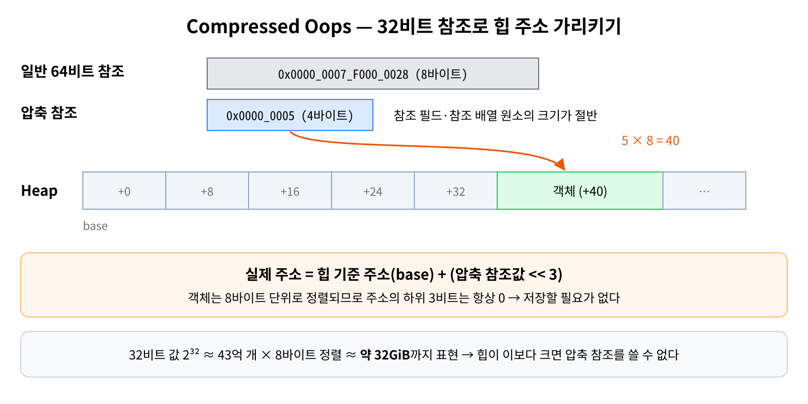
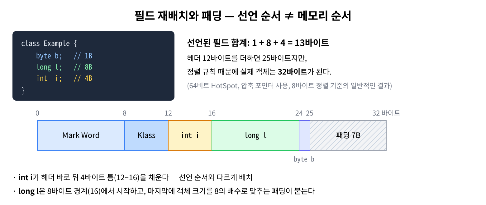
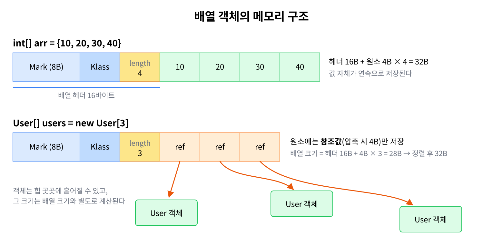
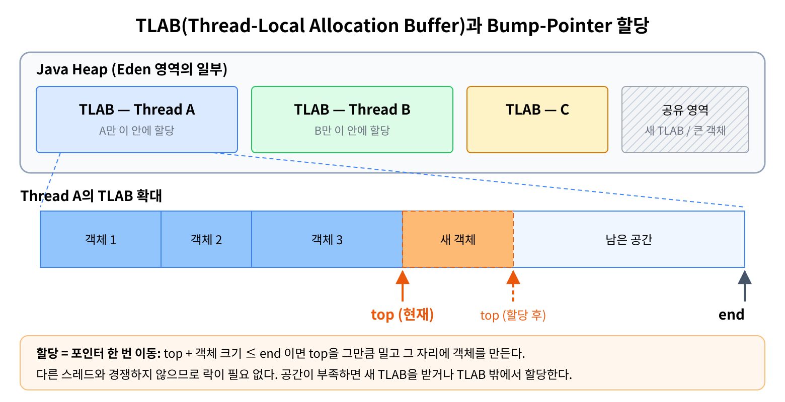
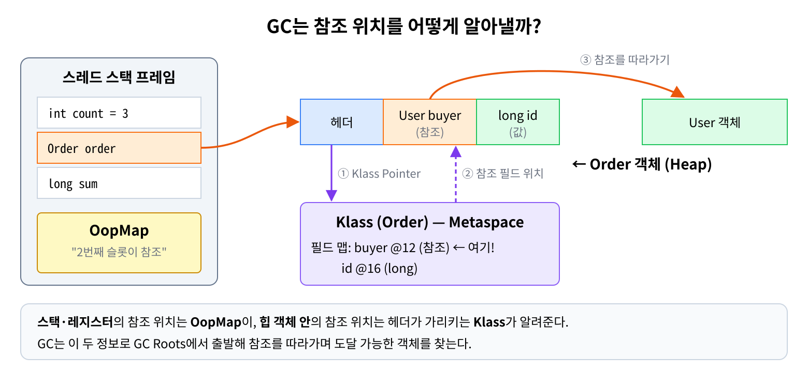

# HotSpot 객체의 메모리 구조와 할당

> 🔗 **연관 문서:** [Garbage Collection과 객체의 생존](./Garbage%20Collection과%20객체의%20생존.md)
> 이 문서는 객체가 **힙에서 어떤 모습으로 존재하고 어떻게 할당되는지**를 다루고, 연관 문서는 그렇게 할당된 객체가 **언제 살아남고 언제 회수되는지**를 다룬다.

## 📁 목차

0.  [📖 용어 정리](#-용어-정리) · [들어가며](#0-들어가며)
1.  [HotSpot의 객체 표현](#1-hotspot의-객체-표현)
2.  [객체 헤더의 구성](#2-객체-헤더의-구성)
3.  [Mark Word와 객체 상태](#3-mark-word와-객체-상태)
4.  [Klass Pointer와 타입 메타데이터](#4-klass-pointer와-타입-메타데이터)
5.  [Compressed Oops와 압축 참조](#5-compressed-oops와-압축-참조)
6.  [필드 배치와 메모리 정렬](#6-필드-배치와-메모리-정렬)
7.  [배열 객체의 메모리 구조](#7-배열-객체의-메모리-구조)
8.  [JDK 25의 Compact Headers](#8-jdk-25의-compact-headers)
9.  [TLAB과 객체 할당 경로](#9-tlab과-객체-할당-경로)
10. [객체 할당과 GC의 관계](#10-객체-할당과-gc의-관계)
11. [운영 환경에서의 관찰](#11-운영-환경에서의-관찰)
12. [전체 흐름 요약](#12-전체-흐름-요약)

------------------------------------------------------------------------

## 📖 용어 정리

> 처음 보는 용어가 나오면 이 표로 돌아와서 확인하자. 본문에서도 처음 등장할 때 💬 상자로 짧게 설명한다.

### JVM과 HotSpot

| 용어 | 쉬운 설명 |
|---|---|
| **JVM** (Java Virtual Machine) | 자바 바이트코드(`.class`)를 실행하는 가상 머신. "Java 프로그램을 돌리는 엔진"의 **규격(명세)** 이다. |
| **HotSpot** | 오라클/OpenJDK가 만든 **대표적인 JVM 구현체**. 우리가 보통 설치하는 JDK의 `java` 명령이 HotSpot이다. 자주 실행되는 코드(=hot spot)를 찾아 기계어로 컴파일하는 데서 이름이 왔다. |
| **JDK / OpenJDK** | Java 개발 도구 모음(컴파일러 + JVM + 라이브러리). OpenJDK는 그 오픈소스 버전이다. |
| **JIT 컴파일러** | 실행 중에 자주 쓰이는 바이트코드를 기계어로 바꿔 빠르게 실행하게 해주는 컴파일러 (Just-In-Time). |
| **JEP** (JDK Enhancement Proposal) | JDK에 새 기능을 넣기 위한 공식 제안서. 예: JEP 519 = Compact Object Headers. |

### 객체 표현

| 용어 | 쉬운 설명 |
|---|---|
| **oop** (Ordinary Object Pointer) | HotSpot 내부에서 **Java 객체를 가리키는 포인터**를 부르는 이름. |
| **메타데이터** | "데이터에 대한 데이터". 여기서는 클래스의 필드 목록, 메서드, 크기 같은 **클래스 설명 정보**. |
| **Klass** | HotSpot이 클래스 메타데이터를 저장하는 내부 구조. `java.lang.Class`와는 다른 것이다. (C++ 키워드 `class`와 겹치지 않게 K로 씀) |
| **Metaspace** | Klass 같은 클래스 메타데이터가 저장되는 **힙 밖의 메모리 영역** (JDK 8부터, 이전의 PermGen을 대체). |
| **객체 헤더** | 모든 객체 앞에 붙는 관리용 공간. Mark Word + Klass Pointer로 구성된다. |
| **Mark Word** | 헤더 중 해시값·GC 나이·락 상태를 담는 8바이트 영역. |
| **Klass Pointer** | 헤더 중 "이 객체의 클래스(Klass)는 어디 있나"를 가리키는 영역. |
| **Identity Hash Code** | `Object.hashCode()`를 재정의하지 않았을 때 쓰이는 객체 고유 해시값. |
| **모니터(Monitor)** | `synchronized`가 쓰는 잠금 장치. 한 번에 한 스레드만 들어가게 한다. |

### 메모리 배치

| 용어 | 쉬운 설명 |
|---|---|
| **정렬(Alignment)** | 데이터를 특정 바이트 배수 주소에 놓는 규칙. HotSpot 객체는 기본 8바이트 배수 주소에서 시작한다. |
| **패딩(Padding)** | 정렬을 맞추려고 끼워 넣는 **빈 공간**. 메모리는 차지하지만 값은 없다. |
| **Compressed Oops** | 64비트 환경에서 객체 참조를 8바이트 대신 **4바이트로 압축**해 저장하는 기술. |
| **CPU 캐시 / 지역성** | CPU 가까이에 있는 작고 빠른 메모리. 자주 쓰는 데이터가 **가까이 모여 있을수록**(지역성이 좋을수록) 빨라진다. |
| **Compact Headers** | 객체 헤더를 12바이트 → **8바이트**로 줄이는 JDK 25 정식 기능. |

### 할당과 GC

| 용어 | 쉬운 설명 |
|---|---|
| **할당(Allocation)** | 새 객체를 위한 메모리 공간을 확보하는 것. |
| **Escape Analysis** | JIT가 "이 객체가 메서드 밖으로 **새어나가는지**(escape)" 분석하는 최적화 기법. |
| **Scalar Replacement** | 밖으로 새지 않는 객체를 아예 만들지 않고, 필드를 **지역 변수처럼 쪼개서** 쓰는 최적화. 힙 할당이 사라진다. |
| **TLAB** (Thread-Local Allocation Buffer) | 스레드마다 미리 떼어준 **전용 할당 구역**. 다른 스레드와 경쟁 없이 객체를 만든다. |
| **Bump-Pointer 할당** | 포인터를 객체 크기만큼 **밀기만 하면** 할당이 끝나는 가장 빠른 할당 방식. |
| **Eden** | 새 객체가 처음 만들어지는 힙 영역 (Young 영역의 일부). |
| **이동식 GC(Moving GC)** | 살아 있는 객체를 다른 위치로 **옮겨서** 메모리를 정리하는 GC. 객체 주소가 바뀔 수 있다. |
| **OopMap** | 컴파일된 코드의 특정 지점에서 "스택/레지스터의 어디에 객체 참조가 있는지" 기록한 지도. |
| **Safepoint** | GC 등을 위해 스레드가 안전하게 멈출 수 있는 코드 지점. |

### 분석 도구

| 용어 | 쉬운 설명 |
|---|---|
| **JFR** (Java Flight Recorder) | JVM에 내장된 **실행 기록기**. 할당, GC, 락 등 이벤트를 낮은 비용으로 기록한다. |
| **JOL** (Java Object Layout) | 객체의 헤더·필드·패딩 배치와 크기를 **직접 출력**해주는 OpenJDK 도구 라이브러리. |
| **Heap Dump** | 특정 시점 힙에 있는 모든 객체를 파일로 떠낸 것. MAT 같은 도구로 분석한다. |
| **Shallow / Retained Size** | 객체 자체 크기 / 그 객체가 사라지면 함께 회수될 수 있는 전체 크기. |

------------------------------------------------------------------------

## 0. 들어가며

Java에서 객체를 생성하면 JVM은 객체에 필요한 메모리를 확보하고 초기화한다. 이때 필요한 것은 필드 값만이 아니다. 런타임이 객체를 식별하고 관리하기 위한 정보도 함께 저장된다.

- Escape Analysis와 Scalar Replacement는 조건을 만족하는 객체의 할당 자체를 제거할 수 있다.
- 실제로 할당이 필요한 객체는 HotSpot의 메모리 관리 구조에 따라 **힙**에 배치된다.

> 💬 **HotSpot이란?** 오라클/OpenJDK가 만든 대표적인 **JVM 구현체**다. JVM 명세는 "무엇을 해야 하는지"만 정하고, "메모리에 어떻게 놓을지"는 구현체마다 다르다. 이 문서의 내용은 우리가 일반적으로 쓰는 HotSpot 기준이다.
>
> 💬 **Escape Analysis / Scalar Replacement란?** JIT 컴파일러가 "이 객체가 메서드 밖으로 나가지 않는다"고 판단하면, 객체를 힙에 만들지 않고 필드를 지역 변수처럼 쪼개서 쓰는 최적화다. 이 경우 아래에서 설명하는 헤더나 TLAB 할당 자체가 일어나지 않는다.
- 객체의 크기는 소스코드에 선언한 필드 크기를 단순히 더한 값과 다를 수 있다.

| 객체 크기에 영향을 주는 요소 | 설명 |
|---|---|
| 객체 헤더 | 런타임 메타데이터를 관리하기 위한 공간 |
| 필드 배치 | 필드 크기와 정렬 요구사항에 따른 배치 |
| 패딩(Padding) | 정렬을 맞추기 위해 생기는 빈 공간 |
| 참조 표현 방식 | Compressed Oops 사용 여부에 따른 참조 크기 |

> 📌 객체 본체가 힙에, 클래스 메타데이터가 Metaspace에 있다는 구분은 [GC 문서의 JVM 메모리 영역](./Garbage%20Collection과%20객체의%20생존.md#jvm-메모리-영역-간단히-살펴보기)에서 먼저 정리했다.

------------------------------------------------------------------------

## 1. HotSpot의 객체 표현

**JVM 명세는 객체의 동작과 실행 의미를 정의하지만, 객체를 실제 메모리에 어떤 형태로 배치할지는 JVM 구현체가 결정한다.**

- Java 객체는 논리적으로 타입, 필드, 객체 식별성을 가진다.
- HotSpot은 일반적인 힙 객체를 **oop**로 다룬다.
    - oop는 Ordinary Object Pointer에서 유래한 용어로, HotSpot 내부에서 Java 객체를 참조할 때 사용된다.

### 핵심 자료구조

| 구조 | 역할 | 위치 |
|---|---|---|
| `oopDesc` | 객체 헤더와, 런타임에서 객체를 다루는 기능을 표현하는 내부 구조 | 힙 (개별 객체) |
| `Klass` | 객체가 속한 Java 클래스의 메타데이터 관리 (필드·메서드 정보, 타입 계층, 객체 크기와 배치 정보 등) | Metaspace |

### 객체와 클래스 메타데이터의 분리

<p align="center"></p>

- 개별 객체의 필드 값은 힙에 존재한다.
- 같은 클래스로 만든 객체들은 각자 독립적인 필드 값을 가지면서 **공통된 클래스 메타데이터를 참조**한다.
- 그래서 객체마다 메서드 정보와 타입 정보를 중복해서 보관할 필요가 없다.
- `java.lang.Class` 객체(그림의 노란 상자)는 힙에 있는 Java 객체로, Metaspace의 Klass와 서로 연결되어 리플렉션 기능을 제공한다.

> 💬 **Metaspace란?** 클래스 메타데이터를 저장하는 **힙 바깥의 네이티브 메모리 영역**이다. JDK 7까지는 PermGen이라는 힙 내부 영역에 있었지만 JDK 8부터 Metaspace로 옮겨졌다.

------------------------------------------------------------------------

## 2. 객체 헤더의 구성

**전통적인 64비트 HotSpot 객체 헤더는 Mark Word와 Klass Pointer로 구성된다.**

| 구성 요소 | 역할 | 크기 (일반적인 구성) |
|---|---|---|
| Mark Word | 객체의 런타임 상태 정보 관리 | 8바이트 |
| Klass Pointer | 객체의 클래스 메타데이터를 찾는 데 사용 | 4바이트 (Compressed Class Pointers 사용 시) |

### 헤더 크기

| 구성 | 헤더 크기 |
|---|---|
| Compressed Class Pointers 사용 (일반적) | 8 + 4 = **12바이트** |
| Compressed Class Pointers 미사용 | 8 + 8 = **16바이트** |
| Compact Headers 사용 ([8장](#8-jdk-25의-compact-headers)) | **8바이트** |

<p align="center"></p>

- 헤더 뒤에 인스턴스 필드와 정렬을 위한 패딩이 추가된다.
- **필드가 하나도 없는 객체도 메모리를 차지한다.**
    - 정렬 단위 8바이트, 헤더 12바이트인 구성이라면 빈 객체도 정렬 결과 **16바이트**를 차지할 수 있다.

### 헤더가 필요한 이유

JVM은 객체마다 타입과 런타임 상태를 관리해야 한다.

- 객체의 실제 크기와 필드 위치 파악
- 메서드 디스패치와 타입 검사 수행
- 동기화 상태 확인
- GC 작업에 필요한 상태 확인

------------------------------------------------------------------------

## 3. Mark Word와 객체 상태

**Mark Word는 객체의 상태를 여러 비트 필드로 표현하는 구조다.** 세부 비트 배치는 HotSpot 버전과 헤더 구성에 따라 달라질 수 있다.

| Mark Word와 연결되는 정보 | 설명 |
|---|---|
| Identity Hash Code | `Object.hashCode()` 또는 `System.identityHashCode()`와 관련된 객체 식별 기반 해시값 |
| 객체 나이(Age) | GC에서 객체가 몇 번의 수집을 살아남았는지 활용하는 정보 |
| 락 상태 | `synchronized` 모니터와 관련된 상태 |

<p align="center"></p>

> 💬 **GC 나이(Age)란?** 객체가 Young 영역에서 일어나는 GC(Minor GC)를 몇 번 살아남았는지 세는 값이다. 일정 횟수 이상 살아남으면 "오래 살 객체"로 보고 Old 영역으로 옮긴다(승격, Promotion).

### Identity Hash Code

- 모든 객체의 해시값을 생성 시점에 미리 계산해 헤더에 기록하지 않는다.
- **필요한 시점에 생성**되고, 이후 같은 객체에 대해 일관된 값을 제공하도록 JVM이 관리한다.
- Identity Hash Code는 **객체의 메모리 주소와 같은 개념이 아니다.**
    - 이동식(Moving) 가비지 컬렉터는 객체를 힙의 다른 위치로 옮길 수 있다.
    - 💬 **이동식 GC란?** 살아 있는 객체들을 한쪽으로 모아(복사·압축) 빈 공간을 한 덩어리로 만드는 GC다. G1, ZGC 등 대부분의 HotSpot GC가 객체를 이동시킨다.
    - 따라서 객체의 식별성을 현재 메모리 주소에 직접 묶어둘 수 없다.

> 🔗 GC가 객체를 이동시키는 이유와 객체 생존 판단 과정은 [GC 문서 - 전체 흐름 요약](./Garbage%20Collection과%20객체의%20생존.md#12-전체-흐름-요약)을 참고한다.

### 동기화 상태

- Java의 `synchronized`는 객체 모니터를 통해 상호 배제를 구현한다.
    - 💬 **모니터 / 상호 배제란?** 모니터는 "한 번에 한 스레드만 들어갈 수 있는 방"의 열쇠 같은 것이다. 상호 배제(Mutual Exclusion)는 여러 스레드가 같은 자원을 동시에 건드리지 못하게 막는 것을 말한다.
- HotSpot은 모니터 상태와 경합 여부에 따라 **헤더의 락 관련 비트**와 **별도의 Monitor 구조**를 함께 활용한다.
- 모니터가 확장된 상태에서는 동기화 정보가 Monitor를 통해 관리될 수 있다.
- 덕분에 모든 객체에 처음부터 완전한 모니터 자료구조를 할당할 필요가 없다.

> 핵심: 객체 헤더는 Java 코드에 직접 노출되지 않지만, JVM이 객체의 런타임 상태를 효율적으로 관리하기 위한 중요한 공간이다.

------------------------------------------------------------------------

## 4. Klass Pointer와 타입 메타데이터

**객체를 참조하는 것만으로는 그 객체의 타입과 필드 배치를 알 수 없다. HotSpot은 헤더의 Klass 정보를 이용해 객체의 런타임 메타데이터에 접근한다.**

### Klass vs java.lang.Class

| 구분 | `Klass` | `java.lang.Class` |
|---|---|---|
| 정체 | HotSpot 내부의 네이티브 메타데이터 | Java 객체 |
| 역할 | 클래스 구조와 실행에 필요한 정보 관리 | 리플렉션 등 클래스 정보를 Java 코드에 제공 |
| 관계 | 서로 연결되어 있지만 역할과 저장 위치가 다름 | |

### Klass 메타데이터의 활용

- **필드 접근:** 클래스 메타데이터에 필드 배치 정보가 있어, 컴파일러가 "객체 시작 주소 + 오프셋"으로 필드에 접근하는 기계어를 생성할 수 있다.
- **타입 확인:** 객체의 실제 타입 검사에 사용된다.
- **가상 메서드 호출:** 실제 호출할 메서드를 결정하는 데 사용된다.
    - 💬 **메서드 디스패치란?** `Animal a = new Dog(); a.sound();`처럼 변수 타입과 실제 객체 타입이 다를 때, 실행 시점에 **실제 타입(Dog)의 메서드**를 찾아 호출하는 과정이다. ([다형성 문서](../다형성.md) 참고)
- **GC의 참조 탐색:** 객체 안에서 어떤 필드가 참조인지 식별하는 데 필요한 정보가 연결된다. ([10장](#10-객체-할당과-gc의-관계) 참고)

> 같은 클래스의 객체가 수백만 개 있어도 클래스 메타데이터는 한 번만 존재한다. 객체마다 필요한 것은 **자신의 필드 값**과 **메타데이터를 찾을 수 있는 정보(Klass Pointer)** 뿐이다.

------------------------------------------------------------------------

## 5. Compressed Oops와 압축 참조

**Compressed Oops(Compressed Ordinary Object Pointers)는 객체 참조를 32비트 값으로 압축해 저장하고, 객체에 접근할 때 실제 주소로 해석하는 방식이다.**

### 왜 필요한가

- 64비트 환경에서 메모리 주소를 그대로 표현하면 참조 하나가 8바이트를 차지한다.
- 연결 리스트, 트리, 맵 엔트리처럼 객체끼리 서로를 많이 참조하는 구조에서는 **참조값 자체가 차지하는 공간**이 무시하기 어려워진다.

> 🔗 변수에 저장되는 것은 객체 자체가 아니라 **참조**라는 점은 [GC 문서 - 객체와 참조의 차이](./Garbage%20Collection과%20객체의%20생존.md#객체와-참조의-차이)에서 다뤘다. Compressed Oops는 바로 그 참조값의 크기를 줄이는 기술이다.

### 동작 원리

- 힙의 **기준 주소(base)** 와 **객체 정렬 단위**를 활용한다.
- 객체가 8바이트 단위로 정렬되어 배치된다면 모든 바이트 주소를 표현할 필요가 없다.
- 압축된 값에 정렬 크기를 곱해(시프트) 주소를 계산하므로, 32비트로 더 넓은 범위를 가리킬 수 있다.

```text
실제 주소 ≈ 힙 기준 주소 + (압축 참조값 × 8)

32비트 값의 범위: 2^32 = 약 4G개
× 8바이트 정렬    = 약 32GiB 주소 범위
```

- 실제 사용 가능 범위는 힙 배치, JVM 옵션, 정렬 설정 등에 영향을 받는다.

<p align="center"></p>

> 💬 **`<< 3`이란?** 왼쪽으로 3비트 이동(시프트)하는 연산으로, 2³ = 8을 곱하는 것과 같다. CPU에서 매우 싸게 처리된다.
>
> 💬 **언제 꺼지나?** 64비트 JVM에서 힙이 약 32GB 미만이면 기본으로 켜진다. `-Xmx`를 32GB 이상으로 잡으면 압축 참조를 쓸 수 없어 참조가 다시 8바이트가 되므로, 오히려 실제로 쓸 수 있는 공간이 줄어드는 구간이 생길 수 있다.

### 효과와 비용

| 구분 | 내용 |
|---|---|
| 메모리 절약 | 참조 필드와 참조 배열 원소의 크기를 8바이트에서 4바이트로 줄임 |
| 캐시 효율 | 같은 캐시 공간에 더 많은 참조와 데이터를 담아 메모리 접근 지역성이 개선될 수 있음 |
| 비용 | 압축 참조를 실제 주소로 해석하는 연산이 필요하지만, HotSpot이 기계어 생성 과정에서 최적화할 수 있음 |

- 압축 여부에 따른 전체 성능은 참조 밀도, 메모리 접근 패턴, CPU 아키텍처 등에 따라 달라진다.

> 💬 **CPU 캐시와 지역성이란?** CPU는 메인 메모리(RAM)보다 훨씬 빠른 작은 저장소(캐시)를 두고, 메모리를 64바이트 단위(캐시 라인)로 가져온다. 필요한 데이터가 작고 가까이 모여 있을수록 한 번에 더 많이 가져올 수 있어 빨라진다. 이것을 "지역성이 좋다"고 한다.

------------------------------------------------------------------------

## 6. 필드 배치와 메모리 정렬

**소스코드에 선언한 필드 순서가 실제 메모리 배치 순서와 항상 같지는 않다.** HotSpot은 필드 크기, 정렬 요구사항, 상속 관계, 내부 배치 정책을 고려해 필드 위치를 결정한다.

| 타입 | 크기 |
|---|---|
| `byte`, `boolean` | 1바이트 |
| `short`, `char` | 2바이트 |
| `int`, `float` | 4바이트 |
| `long`, `double` | 8바이트 |
| 참조 (Compressed Oops 사용 시) | 4바이트 |

### Padding

- 필드를 적절한 경계에 배치하기 위해 필드 사이에 사용되지 않는 공간이 생길 수 있다. 이를 **Padding**이라고 한다.
- 객체 **전체 크기**에도 정렬 규칙이 적용된다.
    - 일반적인 HotSpot 구성의 객체 정렬 단위는 8바이트다. (JVM 옵션과 실행 환경에 따라 다를 수 있음)

### 예시: 객체 크기 계산

```java
class Sample {
    int a;   // 4바이트
    int b;   // 4바이트
}
```

```text
헤더 12바이트 + int 4바이트 + int 4바이트 = 20바이트
8바이트 정렬 적용 → 실제 할당 크기 24바이트 (패딩 4바이트)
```

### 예시: 필드 순서가 바뀌는 경우

<p align="center"></p>

- HotSpot은 헤더 뒤에 남은 빈틈을 작은 필드로 먼저 채우는 등, 낭비가 적도록 필드 순서를 바꾼다.
- 실제 배치는 [JOL](#11-운영-환경에서의-관찰)로 직접 확인할 수 있다.

### 왜 중요한가

- 메모리 정렬은 CPU의 데이터 접근 효율, 객체 참조 표현 방식, 힙 내부 객체 탐색에 영향을 준다.
- 객체 하나의 메모리 사용량 = **필드 합계 + 헤더 + 패딩**
- 객체 하나에서 몇 바이트 차이라도 **수백만 개의 객체에 누적되면** 상당한 힙 사용량 차이로 이어진다.

------------------------------------------------------------------------

## 7. 배열 객체의 메모리 구조

**Java 배열도 객체이므로 헤더와 런타임 타입 정보를 가진다.** 일반 객체와 다른 점은 배열 길이와 원소 저장 공간을 함께 관리한다는 것이다.

### 배열 헤더

| 구성 요소 | 크기 (일반적인 구성) |
|---|---|
| Mark Word | 8바이트 |
| Klass Pointer | 4바이트 |
| 배열 길이 | 4바이트 |
| **합계** | **16바이트** |

배열 원소를 위한 공간은 헤더 뒤에 배치된다.

### 기본형 배열 vs 객체 배열

<p align="center"></p>

- 객체 배열은 객체 자체를 연속해서 저장하지 않고, **각 객체를 가리키는 참조값**을 저장한다.
- Compressed Oops가 활성화되어 있으면 참조 원소 하나는 일반적으로 4바이트다.
    - 참조 100만 개를 담는 배열은 압축 여부에 따라 참조 저장 공간에서 상당한 차이가 난다.
- **배열이 참조하는 객체들의 메모리는 별도로 존재한다.**
    - 배열 하나의 크기만 계산해서 전체 객체 그래프의 메모리 사용량을 추정하면 부족하다.
- 참조된 객체들이 힙의 여러 위치에 흩어져 있으면 접근 패턴과 CPU 캐시 효율에도 영향을 준다.

------------------------------------------------------------------------

## 8. JDK 25의 Compact Headers

**Compact Headers(Compact Object Headers)는 Mark Word와 Klass Pointer를 하나의 64비트 구조로 통합해, 일반적인 객체 헤더를 8바이트로 줄이는 기능이다.**

### 도입 과정

| 버전 | JEP | 상태 |
|---|---|---|
| JDK 24 | JEP 450 | 실험적 기능 (`-XX:+UnlockExperimentalVMOptions` 필요) |
| JDK 25 | JEP 519 | 정식 제품 기능, **기본 비활성화** |

> 💬 **JEP란?** JDK Enhancement Proposal의 약자로, JDK에 새 기능을 넣기 위한 공식 제안서다. 기능마다 번호가 붙는다.
>
> 💬 **Project Lilliput:** Compact Headers를 개발한 OpenJDK 프로젝트 이름이다. (걸리버 여행기의 소인국 이름에서 따왔다)

### 헤더 구조 비교

<p align="center"></p>

- 위 그림 ③처럼 Mark Word 안에 압축된 클래스 정보까지 함께 넣어 헤더 하나를 8바이트로 만든다.

### 효과

- 헤더는 **모든 객체에 반복되는 비용**이다.
- 필드가 적은 작은 객체에서는 헤더가 전체 크기에서 차지하는 비중이 크다.
- 작은 객체가 대량으로 존재하는 서버에서는 전체 힙 사용량과 메모리 접근 패턴에 영향을 줄 수 있다.

### 고려할 점

- 기존 헤더 정보를 더 작은 공간에 담으려면 상태를 표현·해석하는 방식도 바뀌어야 한다.
    - 클래스 정보를 압축해 헤더에 넣고, 락 상태·해시값 등과 함께 관리해야 한다.
- 객체 할당, 타입 접근, 동기화, GC가 모두 헤더와 관련되어 있으므로 **헤더 형식 변경은 런타임 전체에 영향**을 준다.

### 활성화 방법

```bash
java -XX:+UseCompactObjectHeaders -jar app.jar
```

> ⚠️ 옵션 이름은 `-XX:+UseCompactObjectHeaders`다. (`UseCompactHeaders`가 아님)

- 적용 전에는 객체 수와 크기 분포, 사용하는 GC, 힙 사용량, 응답시간 등을 기준으로 효과를 측정해야 한다.

------------------------------------------------------------------------

## 9. TLAB과 객체 할당 경로

**TLAB(Thread-Local Allocation Buffer)은 스레드가 힙에서 할당받아 혼자 사용하는 전용 할당 영역이다.**

> 💬 **비유:** 공용 냉장고(힙)에 모두가 동시에 손을 넣으면 부딪힌다. 그래서 각자에게 칸(TLAB)을 하나씩 나눠주고, 자기 칸 안에서는 줄 서지 않고 바로 넣게 하는 방식이다.

### 왜 필요한가

- 여러 스레드가 동시에 객체를 생성하는 서버에서 모든 할당을 하나의 공유 위치에 대한 동기화로 처리하면 **경합**이 심해진다.
- TLAB을 사용하면 각 스레드는 자신의 TLAB 안에서 다른 스레드와 할당 포인터를 두고 경쟁할 필요가 없다.

### Bump-Pointer Allocation

<p align="center"></p>

> 💬 **Eden이란?** 새로 만든 객체가 처음 놓이는 힙 영역이다. 대부분의 객체는 금방 쓸모없어지므로 Eden에서 태어나 Eden에서 회수된다. TLAB은 주로 Eden 안에 잡힌다.

1. 현재 포인터(top)와 할당 한계(end)를 확인한다.
2. 공간이 충분하면 포인터를 객체 크기만큼 증가시켜 메모리를 확보한다.
3. 객체 헤더와 필드를 초기화한다. (Java가 보장하는 기본값과 생성자 실행 규칙 적용)

### TLAB 공간이 부족하거나 TLAB을 쓰지 않는 경우

- 남은 공간이 부족하면 **새 TLAB을 확보**하거나 다른 할당 경로를 사용한다.
    - 이 과정에는 힙의 공유 할당 영역과 GC의 메모리 관리 정책이 관여한다.
- 객체 크기, 할당 정책, TLAB 상태에 따라 **TLAB 밖에서 할당**될 수 있다.
- 대형 객체는 사용하는 가비지 컬렉터의 별도 할당 정책을 적용받기도 한다.
    - 예: G1은 힙을 Region으로 나누어 관리하며, 큰 객체에는 별도 처리를 적용한다. ([GC 문서 - Card Table과 Remembered Set](./Garbage%20Collection과%20객체의%20생존.md#8-card-table과-remembered-set)에서 Region 개념 참고)

### 흔한 오해

| 오해 | 실제 |
|---|---|
| TLAB의 객체는 스레드 전용 메모리에 영구 저장된다 | TLAB은 **Java 힙의 일부**다. 할당만 스레드별로 나눌 뿐이다 |
| TLAB에 만든 객체는 다른 스레드가 볼 수 없다 | 참조를 전달하면 다른 스레드도 접근할 수 있다 |
| TLAB의 객체는 GC가 따로 관리한다 | GC는 TLAB에 생성된 객체도 일반 힙 객체로 관리한다 |

------------------------------------------------------------------------

## 10. 객체 할당과 GC의 관계

**객체를 빠르게 할당할 수 있다는 것과 객체를 회수하는 비용이 작다는 것은 서로 다른 문제다.**

- 객체를 계속 생성하면 힙 사용량이 증가한다.
- 더 이상 도달할 수 없는 객체는 GC의 회수 대상이 될 수 있다.
- 계속 사용되는 객체는 컬렉터 정책에 따라 살아남거나 다른 영역으로 이동할 수 있다.

> 🔗 "도달할 수 없다"의 정확한 기준은 [GC 문서 - 객체의 생존과 도달 가능성](./Garbage%20Collection과%20객체의%20생존.md#1-객체의-생존과-도달-가능성)을 참고한다.

### GC가 객체 그래프를 탐색하려면

GC는 객체 사이의 참조를 따라가야 하므로, **참조가 어디에 있는지** 정확히 알아야 한다.

| 탐색 대상 | 참조 위치를 알려주는 정보 | 연관 문서 |
|---|---|---|
| 힙 객체 내부의 참조 필드 | 객체 헤더의 Klass Pointer → Klass 메타데이터의 필드 배치 정보 | [4장 Klass Pointer](#4-klass-pointer와-타입-메타데이터) |
| 실행 중인 코드의 스택·레지스터 참조 | OopMap | [GC 문서 - OopMap과 Safepoint](./Garbage%20Collection과%20객체의%20생존.md#oopmap과-safepoint) |
| 탐색의 출발점 | GC Roots | [GC 문서 - GC Roots](./Garbage%20Collection과%20객체의%20생존.md#2-gc-roots) |

<p align="center"></p>

- 이 정보들로 JVM은 **객체의 실제 메모리 배치**와 **프로그램의 참조 관계**를 연결한다.
- 이후 GC는 도달 가능한 객체를 식별하고 ([GC 문서 - Tri-Color Marking](./Garbage%20Collection과%20객체의%20생존.md#4-tri-color-marking)), 알고리즘에 따라 메모리를 회수하거나 살아 있는 객체를 이동시킨다.

> 핵심: 객체 생성, 실행 상태 관리, 가비지 컬렉션은 모두 **공통된 객체 메모리 표현** 위에서 동작한다.

------------------------------------------------------------------------

## 11. 운영 환경에서의 관찰

**Spring Boot 애플리케이션의 메모리를 분석할 때는 힙 크기, 객체 수, 객체별 크기, 참조 관계를 구분해서 봐야 한다.**

### Shallow Size vs Retained Size

| 구분 | 의미 |
|---|---|
| Shallow Size | 객체 자체가 차지하는 메모리 (헤더 + 필드 + 패딩) |
| Retained Size | 그 객체가 유지되지 않으면 함께 회수될 수 있는 객체들의 메모리까지 포함한 크기 |

- 예: 힙에서 특정 DTO 객체가 많이 발견되면, 객체 수와 함께 Shallow Size와 Retained Size를 구분해서 봐야 한다.
- 객체 하나는 작아도 **큰 자료구조를 계속 참조**하고 있다면 전체 메모리에 큰 영향을 준다.

> 🔗 Retained Size와 Dominator Tree, 힙 덤프 분석은 [GC 문서 - 운영 환경에서의 GC 관찰](./Garbage%20Collection과%20객체의%20생존.md#11-운영-환경에서의-gc-관찰)에서 이어서 다룬다. 메모리 누수 원인은 [GC 문서 - Java 메모리 누수](./Garbage%20Collection과%20객체의%20생존.md#10-java-메모리-누수)를 참고한다.

### 관찰 도구

| 도구 | 용도 |
|---|---|
| JFR (Java Flight Recorder) | 객체 할당 활동 관찰 |
| Heap Dump | 특정 시점에 살아 있는 객체의 구조와 참조 관계 분석 |
| JOL (Java Object Layout) | 객체 헤더, 필드 배치, 정렬에 따른 실제 크기 확인 |

```java
// JOL 사용 예시 (의존성: org.openjdk.jol:jol-core)
System.out.println(ClassLayout.parseClass(Example.class).toPrintable());
// → 헤더, 각 필드의 OFFSET/SIZE, 패딩(loss due to alignment)을 출력한다
```

- 실제 객체 크기는 JVM 버전, 압축 참조, 객체 정렬, Compact Headers 설정에 따라 달라진다.
- **분석 대상과 동일한 환경**에서 측정해야 한다.

### 운영 지표

- 할당률(Allocation Rate)
- 힙 사용량
- GC 빈도
- GC 일시 중지 시간(Pause Time)

### 최적화 방향

- 객체 수가 많은 애플리케이션 → 헤더와 참조 공간 절감이 의미 있는 효과를 낼 수 있다.
- 오래 유지되는 객체 그래프가 크거나 대형 배열이 대부분을 차지하는 환경 → 다른 접근이 필요하다.

> 핵심: 메모리 최적화는 객체 하나의 크기를 줄이는 작업에 한정되지 않는다. 실제 할당량, 객체의 생존시간, 참조 관계를 먼저 파악하고 메모리를 많이 쓰는 구조를 찾아야 한다.

------------------------------------------------------------------------

## 12. 전체 흐름 요약

### 객체가 힙에 만들어지기까지

1.  **할당 필요 여부 결정**
    -   Escape Analysis 결과에 따라 할당이 제거될 수도 있다.
2.  **할당 경로 선택**
    -   일반적인 작은 객체는 TLAB에서 Bump-Pointer 방식으로 빠르게 할당된다.
    -   TLAB 공간이 부족하거나 대형 객체라면 다른 경로를 사용한다.
3.  **헤더 초기화**
    -   Mark Word와 Klass Pointer(또는 Compact Header)를 설정한다.
4.  **필드 초기화**
    -   정렬 규칙에 따라 배치된 필드를 기본값으로 초기화하고 생성자를 실행한다.
5.  **GC와의 연결**
    -   GC는 Klass 메타데이터와 OopMap을 이용해 참조를 추적하고, 도달 불가능한 객체를 회수한다. → [GC 문서](./Garbage%20Collection과%20객체의%20생존.md)

### 핵심 개념 비교

| 개념 | 해결하려는 문제 | 핵심 역할 |
|---|---|---|
| Mark Word | 객체별 런타임 상태 관리 | 해시값, GC 나이, 락 상태 관리 |
| Klass Pointer | 객체와 타입 정보 연결 | 클래스 메타데이터 접근 |
| Compressed Oops | 64비트 참조의 메모리 비용 | 참조를 32비트로 압축 |
| Padding / 정렬 | CPU 접근 효율과 주소 표현 | 필드와 객체를 정렬 경계에 배치 |
| Compact Headers | 모든 객체에 반복되는 헤더 비용 | 헤더를 8바이트로 축소 |
| TLAB | 멀티스레드 할당 경합 | 스레드별 전용 할당 영역 제공 |

### 최종 정리

1.  **HotSpot 객체는 필드 값과 함께 런타임이 객체를 관리하기 위한 헤더를 가진다.**
2.  **Mark Word는 해시값·동기화·GC 상태를 관리하고, Klass Pointer는 객체를 클래스 메타데이터와 연결한다.**
3.  **객체의 실제 크기는 헤더 + 필드 + 패딩으로 결정된다.**
4.  **Compressed Oops는 참조 크기를, Compact Headers는 헤더 크기를 줄인다.**
5.  **TLAB은 멀티스레드 환경에서 할당 경합을 줄인다. TLAB도 힙의 일부다.**
6.  **객체의 메모리 표현을 알아야 JVM이 참조를 추적하고 메모리를 회수하는 과정을 이해할 수 있다.**

------------------------------------------------------------------------

## 💡 기억해야 할 핵심

-   **oop:** HotSpot 내부에서 Java 객체를 참조하는 표현
-   **Klass:** Metaspace에 있는 클래스 메타데이터 (≠ `java.lang.Class`)
-   **Mark Word:** 해시값, GC 나이, 락 상태를 담는 헤더 영역
-   **Klass Pointer:** 객체를 클래스 메타데이터와 연결하는 헤더 영역
-   **객체 헤더 크기:** 일반 객체 12바이트, 배열 16바이트, Compact Headers 사용 시 8바이트
-   **Compressed Oops:** 참조를 32비트로 압축 (8바이트 정렬 기준 약 32GiB 범위)
-   **Padding:** 정렬을 맞추기 위한 빈 공간 (객체 크기는 8바이트 배수)
-   **Compact Headers:** JDK 25 정식 기능, `-XX:+UseCompactObjectHeaders`로 활성화
-   **TLAB:** 스레드 전용 할당 영역, Bump-Pointer로 빠른 할당
-   **Shallow / Retained Size:** 객체 자체 크기 / 함께 회수 가능한 크기

> 🔗 **다음으로 읽기:** [Garbage Collection과 객체의 생존](./Garbage%20Collection과%20객체의%20생존.md) — 할당된 객체가 언제 살아남고 언제 회수되는지
